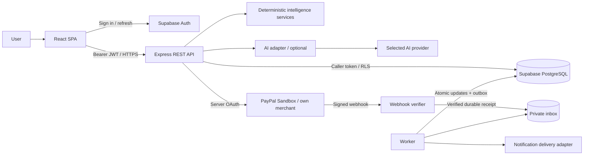

# SubGuard AI architecture

**Never Lose Money on Forgotten Subscriptions.**

SubGuard AI is a subscription protection platform: it explains recurring
spending, predicts likely renewals and surfaces billing risks for user review.
It does not hold customer funds or guarantee prevention of a charge.

## 1. Status and decisions

Phase 6 adds backend-only Gemini assistance, grounded responses, chat persistence
and optional AI mode; see [AI_FINANCIAL_INTELLIGENCE.md](AI_FINANCIAL_INTELLIGENCE.md).
Phase 7 QA is complete for the implemented scope; see
[PHASE_7_QUALITY_ASSURANCE.md](PHASE_7_QUALITY_ASSURANCE.md) for measured results,
verified fixes and limitations. Live provider and hosted Supabase validation remain outstanding; Phase 8 adds guarded integration validation and operational safeguards; see
[PHASE_8_STAGING_READINESS.md](PHASE_8_STAGING_READINESS.md). Hosted services remain
unverified and the release decision is PARTIALLY READY. Phase 9 is not started.

This is the **Phase 1 architecture contract**, not a description of working
integrations. Phase 2 now implements the React frontend and an isolated local
demo adapter following the approved plan; see the
[frontend handoff](FRONTEND_IMPLEMENTATION.md). Phase 3 added Supabase Auth/persistence code and Phase 4 adds the Express API; see
[backend handoff](BACKEND_IMPLEMENTATION.md). These have not been verified against
a live Supabase project. PayPal remains unimplemented; Phase 6 implements the optional Gemini adapter;
the frontend demo requires no credentials. The component and domain
boundaries below remain the target for the later backend phases.

| Decision | Rationale and boundary |
| --- | --- |
| One repository, separate `frontend/`, `backend/`, `database/`, `docs/` | Independent web/API deployments with a shared reviewed API contract; no microservices for the MVP |
| React + Vite + JavaScript | Fast SPA workflow; Tailwind CSS, React Router, Recharts, Lucide React and Framer Motion added in Phase 2 |
| Node 24 LTS + Express + JavaScript REST | Thin controllers; validated schemas compensate for the absence of static types; pin dependency versions with lockfiles when initialized |
| Supabase PostgreSQL + Supabase Auth | Relational constraints, managed identity, per-user RLS; no custom password storage |
| Deterministic domain services | Monetary calculations, anomaly rules and dates are testable and independent of LLM output |
| Optional provider-independent AI | Explanations and suggestions consume constrained facts; unavailable AI cannot block subscription CRUD or calculations |
| PostgreSQL inbox/outbox and a separate worker process | Durable asynchronous work without introducing Redis or a message broker for the MVP |
| Imported transaction history + own-merchant PayPal Sandbox | Honest data coverage; no assumption of a universal bank or merchant transaction API |

The existing README, LICENSE and `.gitignore` are preserved unchanged. The
component READMEs explain each folder; `.gitkeep` tracks reserved empty folders.
There are no placeholder runtime endpoints masquerading as implemented features.
Local demo calculations support the frontend preview only; real-user financial
logic remains a backend responsibility.

## 2. Components and data flow

`backend/src/services` owns ingestion, intelligence, subscriptions, AI, PayPal
and notification modules. Controllers orchestrate services but do not embed
financial formulas. Pure domain functions receive explicit inputs, rule versions
and time; database/network adapters implement side effects. The API and worker
may share a codebase but have separate entry points and health checks.

### Frontend/backend communication

Use `/api/v1` JSON REST over HTTPS in deployment. The browser uses Supabase Auth
directly for sign-in, refresh and sign-out; financial mutations pass through the
API. Attach the session access token as `Authorization: Bearer ...`. The backend
verifies its signature using the project's supported signing keys/JWKS and checks
issuer, audience, expiry and approved algorithm. Mere decoding is insufficient.
Adopt asymmetric Supabase signing keys; if a project uses legacy signing, resolve
its supported verification path before enabling authentication.

Use strict request schemas, bounded pagination and structured errors. The API
derives `user_id` from verified identity; it rejects caller-supplied ownership
fields. Client state reflects loading, empty, error, stale and partially available
conditions. Handle expired sessions without silently switching to demo data.
Money travels as integer minor-unit **strings** plus ISO currency and direction;
never parse those strings as JavaScript floating-point money. Display formatting
may convert only within proven safe bounds. See [API contract](API_DOCUMENTATION.md).

## 3. Identity, ownership and data

Supabase `auth.users` owns `profiles` and each user's sources, transactions,
subscriptions, predictions, alerts and recommendations. Join records link
transactions to subscriptions; detection runs record the rule version and the
input watermark. [Database design](DATABASE_DESIGN.md) specifies proposed keys,
relationships and policies. The schema is a plan until migrations and tests exist.

Ordinary backend requests use the publishable project key plus the caller's JWT
with Supabase's data API, so RLS runs as that caller. Do not run generic user
requests with the service-role key. Each exposed table needs explicit grants,
RLS `USING`/`WITH CHECK` ownership policies and tenant-safe foreign keys. Anonymous
access is denied. Check reads, writes, joins, storage paths and RPCs, not just UI
visibility. Do not expose privileged SECURITY DEFINER functions to clients.

Private payment orders, verified webhook receipts and outbox rows are inaccessible
to browser roles. The service-role credential bypasses RLS: keep it server-only,
use it only through narrow domain-write adapters and the worker, enforce
authenticated ownership and provider object mapping explicitly, and audit that
path. Ingestion and intelligence need protected writes to generated columns;
ordinary reads and user-editable CRUD still run with the caller token. Private
tables cannot be accessed through a non-exposed Data API schema even using a
service key: use reviewed gateway RPCs in an exposed schema, executable only by
the service role, with a pinned search path and fully qualified objects. These
procedures provide atomic batch/inbox/outbox writes; revoke browser execution.
Do not expose raw
SQL or a generic privileged query endpoint. Separate Supabase projects and PayPal
apps for development/test/production prevent cross-environment data mixing.

## 4. Transaction ingestion and provenance

The first real history input is a user-supplied CSV, parsed server-side with a
documented mapping for date, merchant, amount, currency and debit/credit. A manual
subscription can be tracked without inventing a transaction. Demo fixtures are
clearly labeled, isolated and never written as verified provider evidence.

1. Authenticate and authorize the target data source. Enforce upload byte/row
   limits, encoding and schema; reject an invalid batch atomically with row-level
   diagnostics. Treat all CSV cells as untrusted data, including spreadsheet
   formula prefixes if export is later added.
2. Normalize merchant descriptors conservatively; keep original descriptors for
   user review. Parse currency scales with a maintained ISO currency registry,
   amounts as exact minor units and timestamps with an explicit timezone policy.
3. Preserve source, external ID (when available), import batch, recorded time,
   effective time, status and provenance. Pending entries do not become settled
   spending. Refunds/reversals remain linked evidence; they do not erase history.
4. Use a unique source/external ID when authoritative. For CSVs without IDs, use
   a batch idempotency key and row positions to replay the same import safely.
   A normalized content fingerprint can flag overlap for review but must not
   discard legitimate identical purchases in a different batch.
5. Commit a valid batch atomically. The bounded MVP runs intelligence on an
   explicit synchronous request after import, committing its derived results
   atomically. Later automated processing can enqueue an outbox request in the
   import transaction. Retain reproducible evidence in either workflow.

PayPal events cover only resources the configured merchant app is authorized to
see. A SubGuard purchase is incoming revenue to SubGuard; it must not be
classified as the user's external subscription expenditure. Separate payment
integration records from the imported spending ledger.

## 5. Intelligence and core feature contracts

All rules are proposed MVP heuristics. Store a rule version, evidence IDs,
confidence, computation time and last input watermark. Confidence is a heuristic,
not a calibrated probability. Users can confirm/dismiss suggestions and correct
merchant/cadence mappings. Never auto-cancel, move money or label fraud as fact.

| Feature | Inputs | Deterministic processing / control | Outputs | Dependencies |
| --- | --- | --- | --- | --- |
| Recurring transaction detection | Settled debits grouped by owner, source, normalized merchant and currency | At least 3 eligible occurrences; compare calendar-aware weekly/monthly/annual intervals with explicit tolerances; exclude refunds, transfers and known one-offs; score consistency | Reviewable subscription candidate, cadence, evidence and confidence | Ingestion, currency/date helpers, versioned rules, user confirmation |
| Subscription management | Manual entries or accepted candidates; user corrections | Validate cadence, currency and next billing anchor; retain canceled/paused status and evidence links; reject cross-user IDs | User-owned active/paused/canceled records | Auth, RLS, schema validation |
| Upcoming payment prediction | Confirmed subscription anchor/cadence, eligible transactions, user timezone | Advance a local calendar anchor; use median historical settled amount unless a confirmed price is known; annualization uses documented cadence factors | Next date/window, estimated amount, confidence, basis and as-of time | Subscription history, renewal predictions, timezone utilities |
| Price increase detection | Current eligible charge, prior baseline of comparable same-currency charges | Compare against median of last 3 prior eligible charges; require both positive absolute and percentage thresholds; lack of baseline means insufficient evidence | Possible increase alert with old/new amount and evidence | Settled ledger, currency-specific thresholds, alert deduplication |
| Duplicate charge detection | Distinct settled debits, same owner/merchant/currency/amount, close timestamps | Default 24-hour window; exclude replayed provider IDs and known reversals; retain distinct transactions, ask user to confirm | Possible duplicate alert with both transaction IDs | Idempotent ingestion, merchant normalization, alert lifecycle |
| AI financial assistant | User question + minimal authorized aggregate facts/evidence IDs | Intent/data access controlled server-side; adapter explains existing calculations; schema-check response and citations | Grounded explanation, limitations, suggested next steps | Auth, deterministic fact builder, optional AI provider, usage limits |
| Personalized savings recommendations | Confirmed subscriptions, user preferences, validated price/duplicate alerts | Rules rank user-review actions; no inference of non-use from payment data alone; savings expressed per currency/period | Evidence-backed suggestions and potential, non-guaranteed savings | Subscription state, deterministic calculations, optional AI wording |
| Protection dashboard | Subscriptions, predictions, alerts, data freshness | Aggregate per currency; show estimated upcoming totals separately from settled spending; distinguish unknowns/partial history | Currency-specific totals, risk queue, renewal timeline and source coverage | REST summaries, Recharts, accessible UI |
| PayPal Sandbox integration | Authenticated order intent for an allowed server-priced demo product | Create Orders v2 order; user approval through PayPal; server capture with persistent operation keys; reconcile ambiguous responses | Real Sandbox order/capture status, separated from subscription ledger | Sandbox merchant/app credentials, approved Orders permissions |
| Verified webhook processing | PayPal headers, bounded JSON event, configured app/environment/webhook ID | Verify signature with PayPal; unique inbox insert; worker validates resource ownership and reconciles lifecycle | Durable verified receipt, idempotent payment state transition and notification intent | Public HTTPS receiver, PayPal verification API, private inbox/outbox |

### Rule details and limitations

Monthly cadence uses calendar months, not 30-day durations. Retain the original
anchor day: a January 31 anchor clips to February's last day then returns to March
31. Annual leap-day billing clips appropriately. Store the IANA timezone and date
alongside UTC event timestamps; predictions can be date windows rather than
pretending to know an exact future capture time. For date-only CSV records, keep
date precision metadata rather than inventing a precise event time.

Starter thresholds: weekly interval tolerance ±2 days; monthly ±5 days around
calendar anchors; annual ±15 days. Price increases require >5% and at least
one major currency unit expressed with that currency's scale (for USD, 100 minor
units). These are reviewable defaults, to be validated against labeled fixtures;
variable usage billing and taxes can cause legitimate changes. Do not silently
pool currencies, sources or merchants. Sparse history produces an insufficient
evidence state, including annual candidates without enough observations.

For date-only imports, a possible duplicate uses matching/adjacent local calendar
dates and is labeled lower confidence; do not assert an exact 24-hour interval.
Percentage thresholds use integer cross-multiplication rather than floating-point
division. Document rounding to minor units for any non-integer estimate; derived
totals also need overflow bounds before persistence.

An annualized estimate uses weekly ×52, monthly ×12 and annual ×1, explicitly
labeled as an estimate (for a cadence count greater than one, divide by that
count with the documented rounding rule). Savings calculations compare costs in the same currency
and period; do not invent FX rates, usage signals, negotiated discounts or
available competing offers. Alerts use a stable rule/evidence key to prevent
duplicates on reruns. Refunds and corrections invalidate/recompute derived facts.

## 6. AI integration boundary

Define an internal adapter contract such as
`explain({question, facts, evidenceIds, locale}, {signal})`, returning structured
`{text, citations, limitations}`. Keep credentials, model selection and provider
SDKs in backend configuration. Start with one provider and a disabled adapter;
do not install several SDKs speculatively. Add timeout, bounded retry/backoff,
token/cost limits, per-user rate limits and schema validation. If disabled or
timed out, return an explicit unavailable result; the UI still displays
deterministic insights. No fake generated answers as a fallback.

The fact builder scopes queries to the verified user and excludes account numbers,
tokens, raw webhook bodies and unnecessary transaction descriptions. Treat user
questions, merchant strings and model output as untrusted content. The model
cannot choose a user ID, execute SQL, call PayPal, cancel subscriptions or invent
ledger records. Validate citations against the authorized fact set and render
output safely. Compute or confirm every numeric claim in backend logic; reject
unsupported claims. Provide budgeting assistance, not guaranteed savings or
investment/legal advice. Define consent, provider data retention and regional
processing before sending personal financial information externally.

## 7. PayPal integration and verified delivery

Use PayPal Developer Sandbox with a business merchant test account and a separate
buyer test account. Obtain client-credentials OAuth tokens on the server, cache
them only until shortly before expiry and never send them to the SPA. Allow only
known Sandbox API destinations, not URLs supplied by a request. Keep live mode
disabled for the MVP. Server-side prices/currency and caller-to-order mapping
are authoritative; browser approval alone is not successful capture.

Create/capture with a stored `PayPal-Request-Id` per operation, a request digest
and the configured endpoint's supported retention rules. A timeout is ambiguous:
reconcile the provider object before retrying; do not create a second purchase.
Status is derived from authoritative responses and verified events with monotonic
transition rules/reconciliation, not event arrival order or frontend callbacks.

### Webhook protocol

1. Receive a bounded payload on a dedicated public HTTPS route. Preserve the
   original body for the chosen verification method, parse once and retain the
   required PayPal transmission headers. Do not accept caller-supplied webhook IDs.
2. Call the Sandbox `verify-webhook-signature` API with those headers, the
   configured webhook ID and received event. Only `verification_status=SUCCESS`
   permits acceptance. Network failure is not a successful verification; return a
   retryable failure and perform no financial mutation. Never fetch arbitrary
   certificate URLs from an untrusted request in a homegrown verifier.
3. Insert a private inbox row uniquely keyed by provider, environment and event
   ID. A duplicate gets success only after the existing verified durable row is
   found. Persist before acknowledging; failed persistence is retryable. Retain
   a payload hash and quarantine mismatched reuse of an event ID.
4. A worker claims the receipt with a lease and validates its event type,
   merchant/payee, currency, amount and resource/order mapping. A valid signature
   proves delivery provenance, not the user that owns a resource. Do not trust
   `custom_id` or arbitrary event metadata to assign ownership.
5. In one transaction, conditionally apply the legitimate state change, record
   processing outcome and add any outbox notification. Handle duplicates and
   out-of-order/refund events without double-counting; retrieve the authoritative
   provider object when necessary. Retry transient errors with capped backoff;
   expose failed/quarantined receipts for restricted operator inspection.

Follow the [API document](API_DOCUMENTATION.md) for planned routes and error
semantics. Offline fixtures exercise code only; they are never labeled verified
PayPal activity. A real Sandbox acceptance test must use an actual approved and
captured order plus its provider-delivered webhook.

## 8. Notifications and background work

Phase 8 starts with in-app notifications. User timezone/preferences drive renewal
reminders, price-change and duplicate-charge notices. Compute a stable reminder
key from owner, subscription, predicted local date, channel and lead time. A
scheduled job leases due work, checks latest subscription state and atomically
records the notification/outbox intent. A confirmed canceled/paused subscription
suppresses future reminders.

External delivery is at least once: retries need provider idempotency support or
duplicate suppression, and cannot promise exactly-once email. Track pending,
sent, failed and suppressed states, attempt count and next attempt time. Apply
quiet hours and opt-out for optional channels. Email/push providers and credentials
are deferred until a channel is selected; do not leak amounts or merchant names
in lock-screen/email previews by default. Add dead-letter review and logs without
payloads. Run cron/worker separately from the web server; no in-memory timers as
the only scheduler in a multi-instance deployment.

## 9. Security baseline

- Keep PayPal secrets, service-role keys and AI keys server-only. `VITE_*` values
  are public build inputs. Use ignored local `.env` files or deployment secret
  storage; commit only empty templates. Validate required values at startup for
  enabled features, rotate secrets and redact logs and error responses.
- Validate body, query, path and uploaded content with allowlisted fields,
  length/range/enum checks and request size limits. Parameterize database queries;
  reject mass assignment and untrusted redirect/provider URLs. Restrict CORS to
  configured exact origins; CORS is not authentication.
- Use TLS, secure headers and CSP, rate limits by authenticated user and source
  where appropriate, request IDs and generic public errors. Set Express proxy
  trust deliberately for the deployment so forwarded headers cannot spoof limits.
- For SPA bearer tokens, guard against XSS (no unsafe HTML, sanitize rich output,
  no token logging). Decide Supabase session persistence explicitly in Phase 3;
  bearer storage is a risk tradeoff. If cookie auth is later adopted, add
  HttpOnly/Secure/SameSite and CSRF protection rather than mixing mechanisms.
- Limit data collection; do not store full card/bank credentials or PayPal access
  tokens in financial rows. Use managed encryption at rest, least-privilege access
  and encrypted backups; test restore and deletion. Define retention for imported
  data, verified webhook payloads and assistant conversations before public use.
- Enforce RLS plus server ownership checks and test both. Restrict privileged
  worker operations and administrative tooling. Signed events must still be
  deduplicated and matched to owned provider resources.
- Keep audit metadata for imports, user changes and derived rule decisions;
  separate it from raw sensitive data. Do not claim regulatory certification,
  banking connectivity or fraud prevention without evidence and review.

## 10. Testing and deployment plan

Pure domain tests will cover exact amounts, non-2-decimal currencies, calendar
anchors/timezones, sparse history, variable billing, reversals and deterministic
reruns. API integration tests will cover invalid input, expired JWTs, ownership,
idempotency and provider failures. RLS tests must exercise actual anonymous and
two-user sessions. Webhook tests must cover bad signatures, verification outages,
duplicate/concurrent deliveries, crash recovery, mismatched resources and
out-of-order events. Browser tests will cover auth, import, review, prediction and
alert acknowledgement with accessible keyboard operation. Sandbox checks remain
distinct from offline tests. See [roadmap](DEVELOPMENT_PLAN.md) for phase gates.

Deploy the SPA as static assets, the API as a Node service, a worker/scheduler as
a separate process, and PostgreSQL/Auth in Supabase. Use separate environments,
exact CORS/redirect origins, authenticated secrets, a public HTTPS webhook URL,
and migration-before-release checks with rollback/restore procedures. SPA hosting
needs an index fallback for React Router. Keep user data out of frontend builds.
Backend health must distinguish liveness from dependency readiness without
disclosing secrets. Monitor request failures, inbox age, failed jobs, data
freshness and AI spend. The deployment platform/provider is intentionally not
chosen until runtime, region, secrets and job requirements are confirmed.

## 11. External permissions and limits

| Dependency | Needed before integration | Limits / acceptance evidence |
| --- | --- | --- |
| Supabase | Project, Auth redirect configuration, publishable key, server privilege, reviewed migrations and grants | RLS tests and JWT verification against the actual project; no database exists from this scaffolding |
| CSV history | User consent and documented export schema | Incomplete/untrusted history; no automatic account sync or visibility of canceled/unused services |
| PayPal Orders v2 | Developer Sandbox app, merchant and buyer test accounts, OAuth access allowed for the configured app | Own merchant payments only; cannot list arbitrary users' purchases at unrelated merchants |
| PayPal webhooks | Correct app/environment webhook registration and ID, reachable HTTPS receiver, subscribed supported event types, OAuth verification access | Signature verification and resource checks; real provider delivery required for end-to-end evidence |
| PayPal reporting / subscriptions | Explicitly enabled capabilities/permissions if later selected | Reporting is scoped to authorized merchant activity; subscription APIs govern agreements created/managed under that integration, not external subscriptions |
| AI provider | Chosen model/API access, credential, privacy/consent policy and budget | Optional, timeout-prone and fallible; no model is granted financial action permissions |
| Notifications | Scheduler plus in-app storage; provider approval if external channels added | No email/push delivery claim until that provider is implemented and verified |

Do not claim access to external banks, universal PayPal consumer history, automatic
cancellation at other merchants, guaranteed refunds or prevention of renewals.
Those require separate supported integrations, user authorization and possibly
commercial/regulatory approval. Validate current provider documentation and app
permissions during implementation; this phase makes no live provider API claims.

Reference starting points: [Supabase RLS](https://supabase.com/docs/guides/database/postgres/row-level-security),
[Supabase JWTs](https://supabase.com/docs/guides/auth/jwts),
[PayPal Orders v2](https://developer.paypal.com/docs/api/orders/v2/),
[PayPal webhook verification](https://developer.paypal.com/docs/api/webhooks/v1/#verify-webhook-signature_post),
[PayPal idempotency](https://developer.paypal.com/api/rest/reference/idempotency/).
