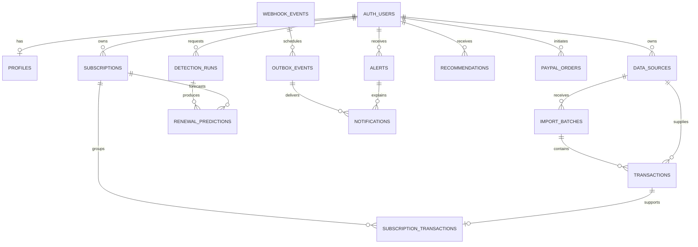

# Database design

Status: proposed Phase 1 design. No database, tables, migrations, RLS policies,
seed data or provider connections have been provisioned by this foundation.
Implementation and executable policy tests belong to Phase 3 and later phases.

Supabase PostgreSQL is the system of record. Supabase Auth owns identities in
`auth.users`; application tables reference its UUIDs rather than storing passwords.
The MVP has one financial workspace per authenticated user. Shared accounts and
organization membership are outside the initial scope.

## Conventions and invariants

- Primary keys are UUIDs. Owned records carry a non-null `user_id` referencing
  `auth.users(id)`. Normal application timestamps use `timestamptz` and UTC.
- Every owned table has `UNIQUE (user_id, id)`. Relationships between owned tables
  use composite foreign keys such as `(user_id, subscription_id)` referencing
  `subscriptions(user_id, id)`. Checking ownership only in a controller is
  insufficient: the database must reject cross-user relationships too.
- Store monetary magnitudes as nonnegative `BIGINT` minor units, paired with a
  supported ISO 4217 currency. Direction (`debit` or `credit`) carries the sign.
  Use a versioned currency-exponent table in deterministic backend code; reject
  unsupported currencies and malformed precision. Never assume every currency
  has two decimal places. Bound values to the PostgreSQL `BIGINT` range.
- APIs serialize `BIGINT` amounts as decimal strings (`"1299"`), avoiding
  JavaScript number precision loss. Parse and calculate with `BigInt` or an
  explicitly selected exact-decimal library, never binary floating-point money.
- Amounts in different currencies remain separate. Dashboard totals and estimated
  savings are grouped by currency. FX conversions require a later explicit rate,
  source and effective timestamp, and are excluded from the MVP.
- Prediction, confidence and recommendation fields are derived evidence, not
  payment instructions or bank balances. Confidence is a numeric score in
  `[0, 1]`, with a rule version and explanation. It is not a calibrated probability
  unless validation later establishes that property.
- Financial records retain provenance: source ID, provider/external ID where
  available, observed timestamp and import/run reference. Imported spending and
  PayPal own-merchant Sandbox checkout records are separate domains. Captures do
  not create spending transactions or feed subscription intelligence.
- Required statuses and numeric bounds use database checks. API validation is
  additional protection. Indexes on `user_id` and referenced foreign keys support
  RLS and scoped queries. Do not add broad JSON indexes without a demonstrated
  query need.

## Relationships

The diagram shows planned logical relationships, including private worker tables.
Every relationship between owned records also includes `user_id` in its key.

## Public application tables

These tables can be in the exposed `public` schema, but all require RLS. Exposure
does not imply that the browser may mutate every table or column.

| Table | Principal columns | Relationships and constraints |
| --- | --- | --- |
| `profiles` | `id` (also the Auth user ID), `user_id` (same UUID), `display_name`, `preferred_currency`, `timezone`, `notification_preferences`, timestamps | `CHECK (id = user_id)`; one profile per user. Validate timezone against supported IANA identifiers. Keep email identity in Auth; store a delivery copy only if needed and explicitly managed. |
| `data_sources` | `id`, `user_id`, `kind`, `label`, `status`, `created_at`, `disconnected_at` | Initial kind is `manual_import` only. A source is provenance, not evidence of universal account access. No OAuth credentials here. Any future PayPal financial-history source requires a separate consent/permission and ingestion design; own-merchant checkout is not such a source. |
| `import_batches` | `id`, `user_id`, `source_id`, `idempotency_key`, `request_digest`, `parser_version`, `status`, `row_count`, `created_at`, `completed_at` | Composite source FK. Unique `(user_id, source_id, idempotency_key)` and `(user_id, source_id, id)` for the transaction/source FK; identical key/digest replays the stored result, while changed input under the same key is rejected. Retain parsing choices and normalized row identities for reproducibility. Bounded MVP batches commit atomically. |
| `transactions` | `id`, `user_id`, `source_id`, `import_batch_id`, `row_identity`, `external_id`, `content_fingerprint`, `merchant_name`, `merchant_key`, `amount_minor`, `currency`, `direction`, `status`, `occurred_at`, `original_local_date`, `timezone`, `date_precision`, `observed_at`, `provider_created_at`, `reversal_of_transaction_id` | Composite source, batch and optional reversal FKs; additionally bind the batch to the same source using a composite `(user_id, source_id, import_batch_id)` FK. Statuses such as `pending`, `completed`, `reversed`; only eligible completed debits enter recurring detection. Unique `(user_id, source_id, external_id)` when an authoritative external ID exists. Unique `(user_id, import_batch_id, row_identity)` replays rows safely. Content fingerprints are review signals, never uniqueness constraints that discard repeated purchases. `date_precision` distinguishes `instant` and `date`; date-only rows retain `original_local_date` and IANA `timezone`, with `occurred_at` null rather than a fabricated instant. |
| `subscriptions` | `id`, `user_id`, `source_id`, `merchant_key`, `display_name`, `status`, `origin`, `cadence_unit`, `cadence_count`, `anchor_date`, `timezone`, `expected_amount_minor`, `currency`, `confidence`, `rule_version`, `explanation`, `user_confirmed_at`, `created_at`, `updated_at`, `version` | Composite source FK; source is required for inferred candidates and may be unknown for a user-created entry. Detection never merges across sources. Statuses `candidate`, `active`, `paused`, `cancelled`, `dismissed`. `origin` distinguishes inferred and user-created entries. Cadence count must be positive; unit initially week/month/year. Nullable expected amount or cadence means unknown, not zero. No automatic merchant cancellation is implied by a local cancelled status. Use optimistic version checks for concurrent edits. |
| `subscription_transactions` | `id`, `user_id`, `subscription_id`, `transaction_id`, `link_origin`, `created_at` | Composite FKs on both parents. Unique `(user_id, transaction_id)` for MVP single-subscription attribution, and unique `(user_id, subscription_id, transaction_id)`. Reassignment is explicit and auditable. |
| `detection_runs` | `id`, `user_id`, `status`, `rule_version`, `input_watermark`, `input_digest`, `started_at`, `completed_at`, `error_code` | Statuses `queued`, `running`, `completed`, `failed`. Input digest and rule version support reproducibility. A run is complete only after its derived writes commit. Avoid storing full financial payloads in error fields. |
| `renewal_predictions` | `id`, `user_id`, `subscription_id`, `detection_run_id`, `expected_local_date`, `window_start`, `window_end`, `amount_minor`, `currency`, `confidence`, `rule_version`, `explanation`, `is_current`, `created_at` | Composite FKs. `window_start <= window_end`; a partial unique index allows only one current prediction per subscription. Store the schedule timezone/anchor used or a versioned subscription snapshot so later edits do not change historical meaning. |
| `alerts` | `id`, `user_id`, `kind`, `subscription_id`, `transaction_id`, `related_transaction_id`, `dedupe_key`, `severity`, `status`, `evidence`, `rule_version`, `created_at`, `resolved_at` | Kinds include `renewal_due`, `price_increase`, `possible_duplicate`. Parent references are nullable but tenant-scoped. Unique `(user_id, dedupe_key)` prevents repeat alerts from reruns. Evidence includes referenced amounts, dates and source IDs; it must not contain credentials. User status changes cannot rewrite evidence. |
| `recommendations` | `id`, `user_id`, `subscription_id`, `kind`, `estimated_savings_minor`, `currency`, `horizon`, `rationale`, `evidence`, `rule_version`, `status`, `created_at`, `expires_at` | Deterministic backend calculates savings from a stated baseline and horizon. A provider may explain that calculation; it cannot supply authoritative amounts. Unknown usage means the app cannot assert that a subscription is unused. Unique recommendation keys prevent equivalent repeat suggestions. |
| `notifications` | `id`, `user_id`, `alert_id`, `channel`, `status`, `created_at`, `read_at`, `delivered_at`, `delivery_key` | Composite alert FK. Unique `(user_id, delivery_key)` covers alert, channel and schedule occurrence. MVP channel is `in_app`; email is optional later. Worker-only delivery status; user may update read state through a constrained operation. |

The exact column names, status enums and constraints must be finalized together
with migrations and API schemas. The invariants above must survive that review.
Use bounded, versioned JSON only for structured evidence and preferences; queryable
amounts, ownership, statuses and relational identifiers remain typed columns.

## Private integration and job tables

Use a dedicated `private` schema that is not exposed through Supabase Data API.
Enable RLS as defense in depth, revoke `anon` and `authenticated` access, and
grant only the narrow server/worker operations that are needed. A service-role
credential bypasses RLS; possession of that credential does not make request
parameters trustworthy. Keep its use in a small server-only adapter.

The non-exposed schema cannot be queried by calling `.schema('private')` through
Supabase Data API, even with a service-role client. Implement reviewed gateway
RPCs in the exposed schema for these internal operations: revoke default/public,
`anon` and `authenticated` execution, grant `EXECUTE` only to `service_role`, use
`SECURITY DEFINER` with a pinned `search_path` and fully qualified object names,
and expose fixed operations rather than arbitrary table/SQL parameters. Each RPC
validates ownership from the authenticated principal supplied by the trusted
backend adapter (or a specific validated worker mapping), validates allowed state
transitions, and performs its required domain/inbox/outbox writes transactionally.
These internal RPCs are separate from any user-callable RPCs. Test their grants
and parameter abuse explicitly. No gateway or direct database access is
implemented in this phase.

| Table | Principal columns | Integrity and access requirements |
| --- | --- | --- |
| `paypal_orders` | `id`, `user_id`, `environment`, `provider_order_id`, `provider_capture_id`, `create_idempotency_key`, `create_request_digest`, `create_provider_request_id`, `create_status`, `create_outcome`, `capture_idempotency_key`, `capture_request_digest`, `capture_provider_request_id`, `capture_status`, `capture_outcome`, `amount_minor`, `currency`, `status`, `created_at`, `updated_at` | Unique `(environment, provider_order_id)` and capture ID when present. Separate unique `(user_id, environment, create_idempotency_key)` and `(user_id, environment, capture_idempotency_key)` indexes scope keys by operation. Store a stable PayPal request ID, request digest, safe outcome and operation status for each create/capture attempt before/after provider calls as appropriate; same key with changed input is rejected. Capture fields are nullable until requested. This bounded MVP supports one capture per order; multi-capture needs a separate operations table. Amount and payee are established server-side. Status changes require verified provider evidence and valid transitions. Expose only a safe owner-scoped projection through backend APIs. These merchant checkout rows never become imported expenses. |
| `webhook_events` | `id`, `provider`, `environment`, `provider_event_id`, `event_type`, `resource_id`, `provider_created_at`, `received_at`, `verified_at`, `payload_digest`, `payload`, `status`, `attempt_count`, `next_attempt_at`, `lease_until`, `last_error_code`, `processed_at` | Unique `(provider, environment, provider_event_id)`. Only verified events enter this trusted inbox. `user_id` may be null until an internal order/subscription mapping identifies the owner; never trust arbitrary webhook metadata as authorization. Same ID with a different digest is quarantined for investigation. Payload retention is short and restricted. |
| `outbox_events` | `id`, `user_id` (nullable for operational events), `event_type`, `aggregate_id`, `dedupe_key`, `payload`, `status`, `attempt_count`, `available_at`, `lease_until`, `created_at`, `completed_at`, `last_error_code` | Unique `dedupe_key`. Insert in the same DB transaction as the financial state/alert change. Workers claim with row locking and a renewable lease, retry with bounded exponential backoff, and retain a terminal failure state for investigation. Payload contains references and minimal delivery context, not entire transaction histories. |

Webhook processing is at-least-once delivery with idempotent effects, not an
exactly-once network guarantee. Verification happens before accepting an event as
trusted. After verification, atomically insert the inbox row or identify an
existing row, and durably schedule processing before returning success. A verified
duplicate can receive success only when the original has been durably accepted.
Processing updates the domain records, inserts outbox work, and marks the inbox
processed in one transaction. A worker crash rolls back that transaction or leaves
a recoverable lease. Return a retriable failure if the inbox cannot be persisted.
Invalid-signature requests do not create financial records or trusted jobs.

Events can arrive out of order. Do not blindly compare arrival timestamps or
overwrite a newer state with an older event. Apply explicit payment-state
transitions; fetch authoritative order/capture status when an event is ambiguous.
Unmapped events remain isolated for reconciliation and never attach to an arbitrary
user. A verified unknown event type may be recorded as ignored without effects.

## Authentication, ownership and RLS

1. Validate the Supabase access token on each protected backend request, including
   signature, issuer, audience and expiry. Resolve `user_id` from the validated
   subject, never from request bodies, route parameters or client claims alone.
2. Use a request-scoped Supabase client carrying the user's token for ordinary
   authorized reads and user-editable CRUD. Public/publishable keys are not
   authorization controls. Derived ingestion and intelligence writes use the
   narrow privileged adapter described below, rather than granting the caller
   write access to generated evidence.
3. On each owned exposed table, enable RLS. Select policies require
   `auth.uid() = user_id`. Any permitted insert uses the same `WITH CHECK`; update
   policies need both ownership in `USING` and `WITH CHECK`. Unauthenticated
   clients receive no financial data. Avoid broad all-operation policies.
4. Limit browser writes to intentionally editable data. Profile settings and
   subscription preferences can use narrow grants or RPCs. Transactions,
   predictions, run status, alert evidence, savings amounts and notification
   delivery fields are server-generated and not client-writable. Use column
   privileges or narrow functions; RLS alone does not protect individual columns.
5. Backend ingestion, intelligence and integration writes that need elevated
   privileges must pass through narrow operation-specific adapters/RPCs, repeat
   ownership validation, use composite foreign keys, and expose no general-purpose
   privileged CRUD/query endpoint. A financial write helper accepts an already
   authenticated principal, not an unchecked request `user_id`. Service-role
   bypass of RLS means these checks are essential. Internal worker paths require
   separate server auth and verified resource-to-owner mappings.
6. Use `SECURITY INVOKER` for user-scoped functions by default. If a narrowly scoped
   `SECURITY DEFINER` function is necessary, pin `search_path`, fully qualify objects,
   revoke default execution grants, validate ownership inside it and test bypass
   attempts. Do not expose private tables through permissive views or functions.

RLS acceptance tests must use two real test users plus an unauthenticated client:
cross-user select/update/delete, forged ownership on insert, cross-user composite
references, read-only generated fields, private table access, and safe-view access.
Run them against Supabase locally or an isolated test project, never production.
No RLS protection is claimed until these tests and migrations exist and pass.

## Transaction ingestion and reproducible intelligence

Manual imports require an explicit user action and a documented input format.
Normalize merchant descriptions conservatively while retaining the source label.
Validate currency, amounts, dates, row count and payload size before persistence.
Use authoritative external identifiers where available. For CSVs without IDs,
persist a batch idempotency key, digest and stable row positions/identities, and
use the batch/row uniqueness constraint to replay that batch safely. A versioned
content fingerprint can flag overlap across batches for review but must never
silently collapse identical-looking purchases across batches. Reimporting with a
new batch key can require explicit overlap review; it cannot promise automatic
perfect deduplication without stable source IDs. Possible duplicate-charge
detection is separate from import replay and retains both charge records.

Record completed charges and credits/reversals without silently deleting history.
Net spend and recurring detection must handle reversals explicitly. Refunds are
not new subscription charges. A refund may link to its original transaction when
the source provides reliable evidence; do not invent a link from amount alone.

Detection runs consume an explicit completed-data watermark and versioned rules.
Group by owner, source, normalized merchant and currency, then evaluate cadence
and amount consistency; require sufficient observations and preserve candidate
status until user confirmation. Reruns upsert stable
subscription and alert identities rather than multiplying results. Persist the
input digest and relevant transaction references so explanations are inspectable.

Renewals use a local calendar anchor and IANA timezone. Monthly schedules must
define month-end behavior (clamp to the final valid day while preserving the
original anchor); do not approximate months as thirty days. Preserve date-only
inputs as dates rather than inventing an exact UTC payment time. For both instant
and date-only transactions, populate `original_local_date` in the recorded source
timezone so date-based filtering and stable pagination do not depend on a nullable
`occurred_at`. Do not invent cross-timezone instants for date-only analytics.
Prediction windows
must express uncertainty, missed-cycle assumptions and insufficient history.

## Retention, privacy and deletion

Keep credentials and provider access tokens out of application rows, logs, prompts
and browser bundles. Use deployment secret storage; no card numbers, bank login
credentials or payment authorization secrets belong in this schema. Restrict
database administration access and encrypt transport and managed storage.

Send AI only the minimum scoped facts needed for a user-requested explanation;
prefer merchant aliases and deterministic aggregates over raw statement text.
AI provider output is untrusted text. Do not let generated SQL, tool calls or
recommended actions write financial records without explicit bounded server
validation and any required user confirmation.

Conversation persistence is deferred. If later required, introduce owned
`assistant_threads` and `assistant_messages` with the same composite ownership
rules, redaction, bounded retention, user deletion and provider-data disclosure.
An MVP request can be stateless without creating chat-history tables.

Before production, define documented retention periods for source transactions,
webhook payloads, notification delivery logs and backups. Keep verified event IDs
and processing receipts long enough to prevent replay during supported provider
retry/reconciliation windows; do not purge deduplication state with short-lived raw
payloads. User deletion must revoke connections and purge/anonymize owned data,
including private rows and derived evidence, with explicit treatment of any legal
retention requirement. Auth deletion alone is not a complete deletion workflow.

## Migration and verification plan

Use ordered, reviewable SQL migrations under `database/migrations/`, applied first
to a disposable Supabase environment. Never edit an already applied migration or
paste service keys into SQL. Verify constraints, grants, policies and indexes after
applying migrations, and test a clean database setup as well as an upgrade path.
Production changes require backups and a recovery plan; destructive table resets
are not an application startup action.

Required database checks in later phases:

- Ownership and RLS cases listed above, including private-schema denial.
- Exact money parsing, zero/three-decimal currencies, overflow and cross-currency
  rejection; no implicit conversion in totals or recommendations.
- Repeat import, legitimate same-day charges, refunds and atomic ingestion.
- Batch-key replay and changed-input rejection; identical rows across distinct
  batches are flagged for review rather than silently deleted; date-only rows do
  not acquire fabricated UTC timestamps.
- Concurrent webhook delivery, duplicate IDs, mismatched payloads, out-of-order
  events, transaction rollback and worker lease recovery.
- Prediction month ends, leap years, daylight-saving transitions and unknown dates.
- Transaction/outbox atomicity and repeat notification delivery attempts.
- Clean migration replay, expected indexes and account-deletion behavior.

PayPal Sandbox can demonstrate only own-merchant checkout orders/captures created
for the configured app and permissions actually granted. Their verified records
remain separate from the spending ledger and subscription detection. This model
does not
provide universal access to a customer's bank or unrelated merchant transactions.
Any future financial-data provider needs a separate consent, permission, security
and ingestion design before it becomes a supported `data_sources.kind`.
